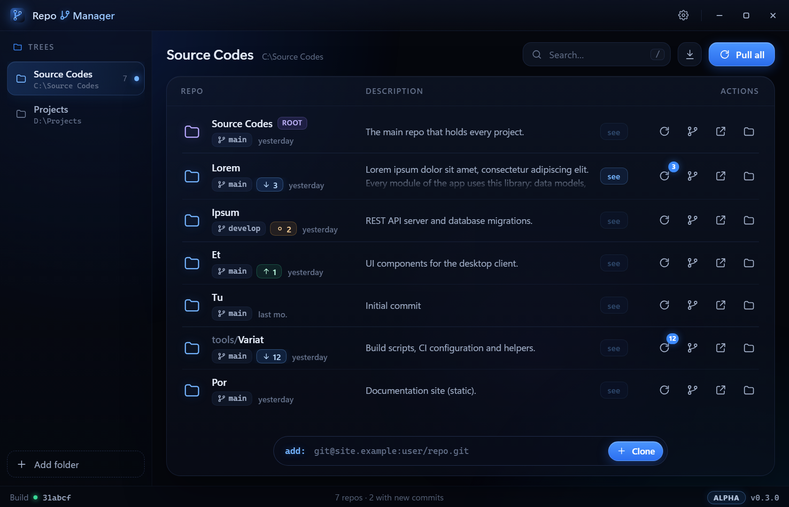
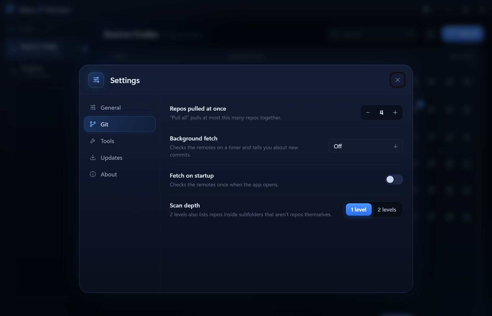

<p align="center">
  
</p>

<h1 align="center">Repo Manager</h1>

<p align="center">
  A lightweight Windows app that keeps every git repo in a folder up to date from one window.<br>
  <sub><b>English</b> · <a href="README.tr.md">Türkçe</a></sub>
</p>

<p align="center">
  <a href="https://github.com/zearkreast/repo-manager/releases/latest"></a>
  
  
  <a href="LICENSE"></a>
</p>

<p align="center">
  <a href="https://github.com/zearkreast/repo-manager/releases/latest"></a>
  <a href="https://github.com/zearkreast/repo-manager/releases/latest/download/RepoManager_x64-portable.exe"></a>
</p>

<p align="center">
  
</p>

Point Repo Manager at the folder that holds your projects, such as `Source Codes`, and it lists every git repo inside with its branch, how far behind or ahead it is, and what changed. One click pulls a repo; **Pull all** pulls them all. The folder itself can be a repo too: it shows up with a **root** tag.

```
Source Codes (git)      ← listed with the "root" tag
├── project-a
├── project-b
└── tools
    └── helper          ← listed as tools/helper with a scan depth of 2
```

## Features

- **Safe pulls:** every pull is `git pull --ff-only`, so your local work is never merged or rebased. Common errors (no upstream, diverged branches, local changes, no access) are explained in plain words.
- **Pull all:** pulls up to 8 repos at once (4 by default), with live progress on each row.
- **At a glance:** branch, commits behind ↓ and ahead ↑, changed files and the last commit's age on every row.
- **Description from the README:** the README's introduction shows next to each repo; **see** expands it in place. A double click opens the full README.
- **Branch menu:** fetch, switch to a local branch, or check out a remote one as a tracking branch.
- **Open in…:** Windows Terminal, PowerShell or Command Prompt; VS Code, Cursor, VSCodium, Zed or any editor command; the remote in your browser; the folder in Explorer.
- **Clone:** paste a git address into **add:** and it is cloned into the selected folder with a progress bar.
- **Background fetch:** optionally checks the remotes every 5 to 60 minutes and tells you which repos have new commits.
- **Automatic updates:** the installed app checks GitHub for a new release and installs it after verifying its signature.
- **English and Turkish:** follows the Windows display language; you can pick one under Settings.
- **Small:** a single exe of a few megabytes that runs the `git` already on your PC.

Shortcuts: `/` search · `Ctrl+R` fetch and refresh · `F5` rescan · `Ctrl+,` settings · `Esc` close.

<p align="center">
  
</p>

## Settings

| Section | Options |
|---|---|
| General | Language (System, Türkçe, English) · Animations (System, Full, Reduced) |
| Git | Repos pulled at once (1–8) · Background fetch (off, 5, 15, 30, 60 min) · Fetch on startup · Scan depth (1 or 2 levels) |
| Tools | Terminal (Auto, Windows Terminal, PowerShell 7, Windows PowerShell, Command Prompt) · Editor (VS Code, Cursor, VSCodium, Zed or a custom command) |
| Updates | Check automatically · Check now |

Settings and the folder list are stored in `%APPDATA%\dev.repomanager.app\config.json`.

## Install

Requirements: Windows 10 or 11 (WebView2 comes with Windows) and `git` on your PATH.

- **Installer** (`Repo.Manager_<version>_x64-setup.exe`): installs for your user and updates itself.
- **Portable** (`RepoManager_x64-portable.exe`): a single exe, no install. It tells you about new releases and opens the download page. Put it inside your projects folder and that folder is added on first launch.

The exe is not code-signed, so Windows SmartScreen may warn the first time you run it.

## Building

You need Rust, Node.js and the Visual Studio C++ build tools.

```powershell
npx @tauri-apps/cli@2 build
```

This writes `src-tauri\target\release\repo-manager.exe` and the installer under `src-tauri\target\release\bundle\nsis\`. A local build without the updater signing key needs `--config '{"bundle":{"createUpdaterArtifacts":false}}'`.

Unit tests: `cargo test --manifest-path src-tauri/Cargo.toml`.

The interface is plain HTML, CSS and JavaScript in `src/`. Open `src/index.html` in a browser to see it with sample data; `?lang=en` or `?lang=tr` picks the language.

### Releases

Pushing a `v*` tag that matches the version in `src-tauri/tauri.conf.json` runs the Release workflow. It builds the installer and the portable exe, signs the update and publishes the release with `latest.json`, which installed copies read to update themselves. The workflow needs the `TAURI_SIGNING_PRIVATE_KEY` repository secret.

## License

[GPL-3.0](LICENSE)
