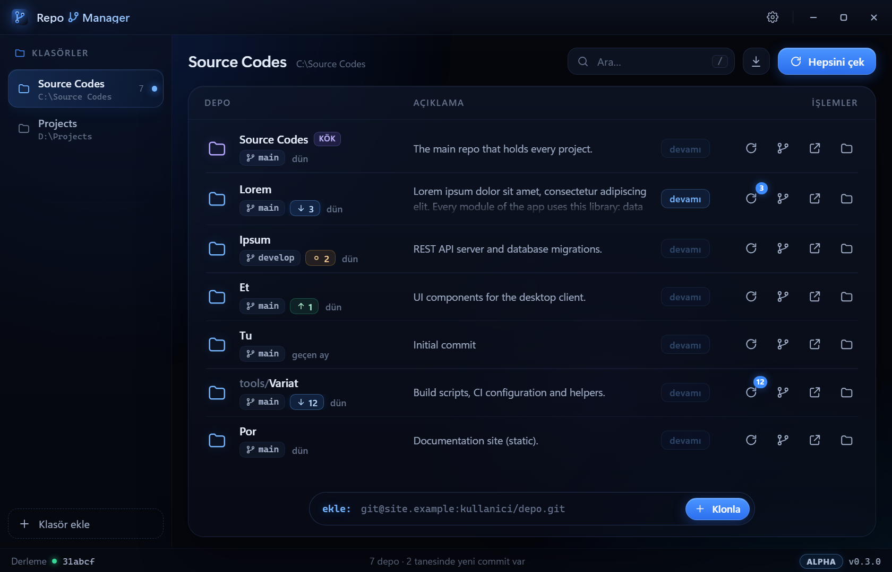
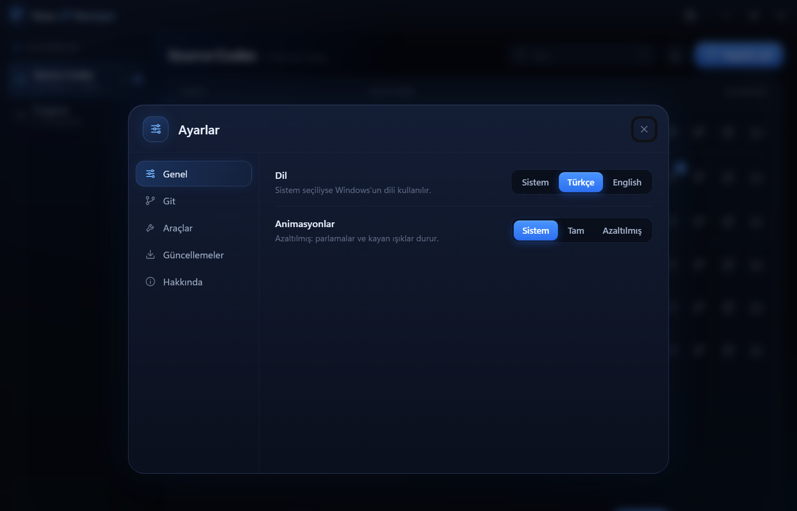

<p align="center">
  
</p>

<h1 align="center">Repo Manager</h1>

<p align="center">
  Bir klasördeki bütün git depolarını tek pencereden güncel tutan hafif Windows uygulaması.<br>
  <sub><a href="README.md">English</a> · <b>Türkçe</b></sub>
</p>

<p align="center">
  <a href="https://github.com/zearkreast/repo-manager/releases/latest"></a>
  
  
  <a href="LICENSE"></a>
</p>

<p align="center">
  <a href="https://github.com/zearkreast/repo-manager/releases/latest"></a>
  <a href="https://github.com/zearkreast/repo-manager/releases/latest/download/RepoManager_x64-portable.exe"></a>
</p>

<p align="center">
  
</p>

Repo Manager'a projelerinizin bulunduğu klasörü (ör. `Source Codes`) gösterin; içindeki her git deposunu branch'i, kaç commit geride ya da ileride olduğu ve neyin değiştiğiyle birlikte listeler. Tek tıkla bir depoyu, **Hepsini çek** ile hepsini çekersiniz. Klasörün kendisi de bir depo olabilir; listede **kök** etiketiyle görünür.

```
Source Codes (git)      ← "kök" etiketiyle listelenir
├── proje-a
├── proje-b
└── araclar
    └── yardimci        ← tarama derinliği 2 iken araclar/yardimci olarak listelenir
```

## Özellikler

- **Güvenli çekme:** her çekme `git pull --ff-only` ile yapılır; yerel çalışmanız asla birleştirme ya da rebase ile değişmez. Sık görülen hatalar (upstream yok, dallar ayrışmış, yerel değişiklik var, erişim yok) anlaşılır biçimde yazılır.
- **Hepsini çek:** aynı anda 8 depoya kadar çeker (varsayılan 4); her satırda ilerleme canlı görünür.
- **Bir bakışta:** her satırda branch, ↓ geride ve ↑ ileride commit sayısı, değişmiş dosyalar ve son commit'in yaşı.
- **README'den açıklama:** README'nin giriş bölümü deponun yanında görünür; **devamı** onu yerinde açar. Çift tık README'nin tamamını açar.
- **Branch menüsü:** fetch, yerel branch'e geçiş ya da uzak branch'i takip eden yeni bir yerel branch olarak alma.
- **Dışarıda aç:** Windows Terminal, PowerShell ya da Komut İstemi; VS Code, Cursor, VSCodium, Zed ya da herhangi bir editör komutu; uzak depo tarayıcıda; klasör Gezgin'de.
- **Klonlama:** **ekle:** alanına git adresini yapıştırın, seçili klasöre ilerleme çubuğuyla klonlanır.
- **Arka planda fetch:** isterseniz uzak depoları 5 ile 60 dakika arasında bir denetler ve hangi depolarda yeni commit olduğunu söyler.
- **Otomatik güncelleme:** kurulu uygulama GitHub'da yeni sürüm arar, imzasını doğruladıktan sonra kurar.
- **Türkçe ve İngilizce:** Windows'un görüntü dilini izler; Ayarlar'dan birini seçebilirsiniz.
- **Küçük:** birkaç megabaytlık tek bir exe; bilgisayarınızdaki `git`'i kullanır.

Kısayollar: `/` arama · `Ctrl+R` fetch ve yenile · `F5` yeniden tara · `Ctrl+,` ayarlar · `Esc` kapat.

<p align="center">
  
</p>

## Ayarlar

| Bölüm | Seçenekler |
|---|---|
| Genel | Dil (Sistem, Türkçe, English) · Animasyonlar (Sistem, Tam, Azaltılmış) |
| Git | Aynı anda çekilen depo (1–8) · Arka planda fetch (kapalı, 5, 15, 30, 60 dk) · Açılışta fetch · Tarama derinliği (1 ya da 2 seviye) |
| Araçlar | Terminal (Otomatik, Windows Terminal, PowerShell 7, Windows PowerShell, Komut İstemi) · Editör (VS Code, Cursor, VSCodium, Zed ya da özel komut) |
| Güncellemeler | Otomatik denetle · Şimdi denetle |

Ayarlar ve klasör listesi `%APPDATA%\dev.repomanager.app\config.json` dosyasında tutulur.

## Kurulum

Gereksinimler: Windows 10 ya da 11 (WebView2 Windows ile gelir) ve PATH'te `git`.

- **Kurulum dosyası** (`Repo.Manager_<sürüm>_x64-setup.exe`): kullanıcınız için kurar ve kendini günceller.
- **Taşınabilir** (`RepoManager_x64-portable.exe`): tek exe, kurulum yok. Yeni sürüm çıkınca haber verir ve indirme sayfasını açar. Projelerinizin klasörüne koyarsanız ilk açılışta o klasör eklenir.

Exe kod imzalı değildir; Windows SmartScreen ilk çalıştırmada uyarı gösterebilir.

## Derleme

Rust, Node.js ve Visual Studio C++ derleme araçları gerekir.

```powershell
npx @tauri-apps/cli@2 build
```

Çıktı `src-tauri\target\release\repo-manager.exe` ve `src-tauri\target\release\bundle\nsis\` altındaki kurulum dosyasıdır. Güncelleme imza anahtarı olmadan yerel derleme için `--config '{"bundle":{"createUpdaterArtifacts":false}}'` ekleyin.

Birim testleri: `cargo test --manifest-path src-tauri/Cargo.toml`.

Arayüz `src/` içinde saf HTML, CSS ve JavaScript'tir. `src/index.html` dosyasını tarayıcıda açarsanız örnek verilerle görünür; `?lang=tr` ya da `?lang=en` dili seçer.

### Sürüm yayınlama

`src-tauri/tauri.conf.json` içindeki sürümle eşleşen bir `v*` etiketi push edilince Release iş akışı çalışır. Kurulum dosyasını ve taşınabilir exe'yi derler, güncellemeyi imzalar ve kurulu kopyaların kendini güncellemek için okuduğu `latest.json` ile birlikte sürümü yayınlar. İş akışı `TAURI_SIGNING_PRIVATE_KEY` depo sırrını ister.

## Lisans

[GPL-3.0](LICENSE)
